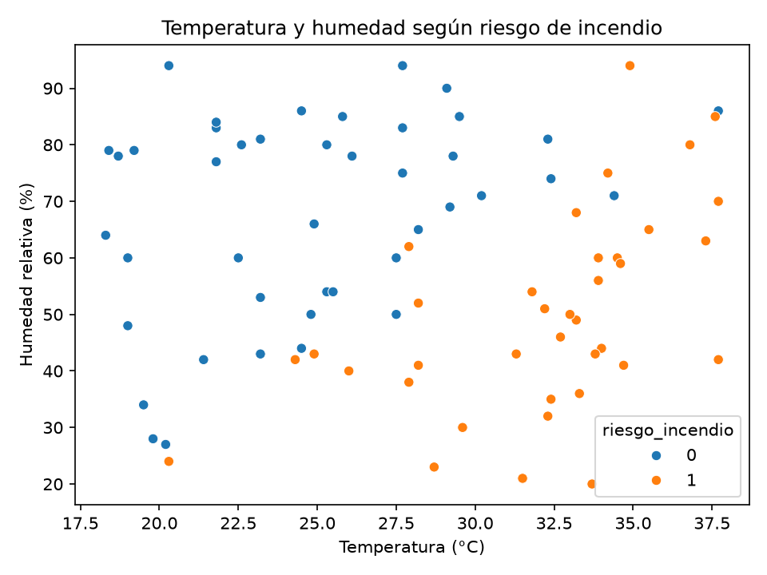
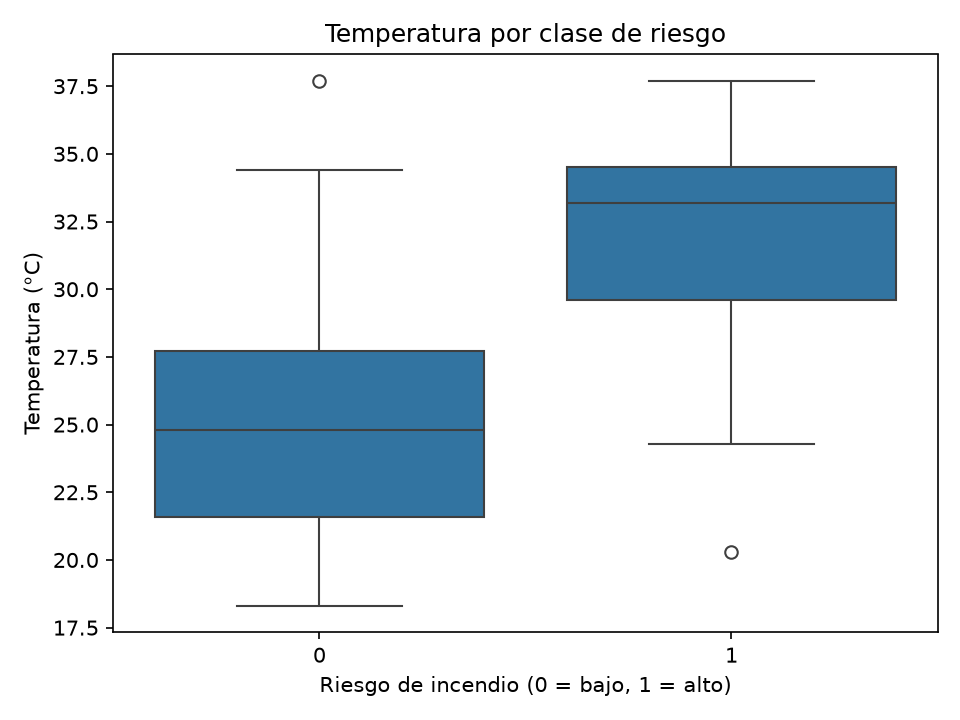
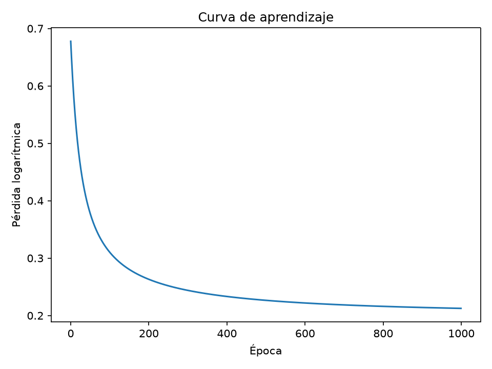
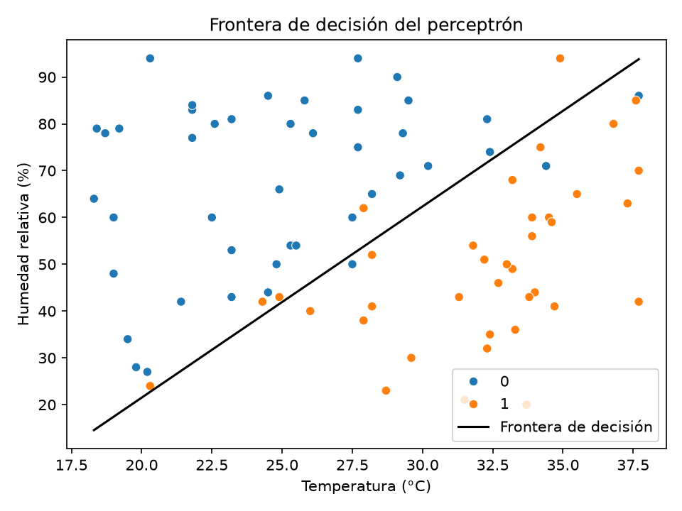

# Parcial 2 de Inteligencia Artificial — Grupo 12

**Estudiante:** Mónica Alejandra Parra Quintero  
**Asignatura:** Inteligencia Artificial — Ingeniería de Sistemas  
**Tema:** Riesgo de incendio forestal en Cartago, Valle del Cauca  
**Entradas del modelo:** temperatura y humedad relativa  
**Variable objetivo:** `riesgo_incendio` (1 = riesgo alto, 0 = riesgo bajo)

## 1. Objetivo

Este proyecto analiza si la temperatura y la humedad relativa permiten estimar si un registro corresponde a riesgo alto de incendio forestal. El trabajo comprende la inspección y limpieza de los datos, su visualización y el entrenamiento de un clasificador con una sigmoide implementado desde cero con NumPy.

Es un ejercicio académico de clasificación binaria. El modelo no constituye un sistema operativo de alerta de incendios.

## 2. Datos y estructura del repositorio

El archivo original contiene cinco columnas:

| Columna | Uso |
|---|---|
| `registro_id` | Identificador del registro; se conserva para consultar los datos. |
| `vereda` | Categoría geográfica; se conserva para inspección y limpieza. |
| `temperatura_c` | Primera entrada numérica del modelo. |
| `humedad_relativa_pct` | Segunda entrada numérica del modelo. |
| `riesgo_incendio` | Objetivo: 1 = riesgo alto, 0 = riesgo bajo. |

El modelo utiliza solamente `temperatura_c` y `humedad_relativa_pct` como entradas.

```text
parcial2-ia-grupo12/
├── data/
│   ├── grupo_12.csv
│   ├── grupo_12_limpio.csv
│   ├── grafico_dispersion.png
│   ├── grafico_boxplot.png
│   ├── curva_aprendizaje.png
│   └── frontera_decision.png
├── src/
│   └── parcial2.py
├── Dockerfile
├── docker-compose.yml
├── requirements.txt
└── README.md
```

## 3. Entorno y ejecución

El proyecto se trabaja desde Visual Studio Code con una terminal WSL. Docker utiliza Python 3.12 e instala NumPy, Pandas, Matplotlib y Seaborn.

Desde la raíz del repositorio, construir la imagen y ejecutar el programa:

```bash
docker compose up --build
```

El contenedor se llama `parcial2_ia`. El programa termina cuando acaba el análisis; no es necesario dejar el contenedor ejecutándose.

Para volver a ejecutar el programa después de construir la imagen:

```bash
docker compose run --rm parcial2
```

## 4. ¿Cómo funciona el código?

El programa principal está en `src/parcial2.py`. Sus pasos son:

1. **Carga e inspección:** Pandas lee `data/grupo_12.csv` y muestra las primeras filas, dimensiones, tipos de datos, valores nulos y duplicados.
2. **Limpieza:** elimina filas duplicadas, convierte la humedad a número, completa los valores faltantes y corrige la temperatura sospechosa de `I070`. Guarda el resultado en `data/grupo_12_limpio.csv`.
3. **Visualización:** Seaborn y Matplotlib generan el gráfico de dispersión, el boxplot, la curva de aprendizaje y la frontera de decisión. Los cuatro gráficos se guardan en `data/`.
4. **Preparación de entradas:** NumPy extrae las dos columnas numéricas, calcula sus medias y desviaciones estándar, y estandariza los valores.
5. **Entrenamiento:** el código implementa la sigmoide, la probabilidad, la pérdida logarítmica y la exactitud. Después actualiza los pesos y el sesgo mediante descenso del gradiente durante 1000 épocas.
6. **Evaluación:** calcula la exactitud y los errores sobre los mismos datos utilizados para entrenar, dibuja la frontera y calcula probabilidades para dos registros nuevos.

La probabilidad se calcula con la expresión `sigmoide(X @ w + b)`, donde `X` contiene las entradas estandarizadas, `w` son los pesos y `b` es el sesgo. Una probabilidad igual o superior a 0.5 se clasifica como riesgo alto (1); una probabilidad inferior a 0.5, como riesgo bajo (0).

El perceptrón se implementó con NumPy. No se utilizó Scikit-Learn ni otra librería de aprendizaje automático.

## 5. Inspección y limpieza de los datos

El archivo original tiene **84 filas y 5 columnas**. Pandas leyó `temperatura_c` como número decimal (`float64`), pero `humedad_relativa_pct` como texto (`str`). Esto sucede porque algunos valores de humedad incluyen el símbolo `%`.

La inspección detectó:

- **3 valores de humedad faltantes.**
- **3 valores de humedad escritos con `%`.**
- **4 filas duplicadas exactas**, correspondientes a los registros `I018`, `I019`, `I047` e `I063`.
- Una temperatura sospechosa de **96.8 °C** en el registro `I070`, de Zaragoza.

Antes de limpiar, había 45 registros de clase 0 y 39 de clase 1.

### Decisiones de limpieza

| Problema | Decisión | Justificación |
|---|---|---|
| Cuatro filas repetidas exactamente | Eliminar las filas duplicadas | Una repetición idéntica contaría dos veces el mismo registro y afectaría el entrenamiento. |
| Humedad leída como texto | Quitar `%` y convertir la columna a número | El modelo requiere entradas numéricas para estandarizar y calcular probabilidades. |
| Tres humedades faltantes | Imputar con la mediana de la columna: 60 % | Permite conservar esos registros y evita usar una media sensible a valores extremos. |
| Temperatura de 96.8 °C en `I070` | Reemplazar por 24.9 °C | Se utilizó la mediana de las temperaturas válidas de Zaragoza. El archivo no permite recuperar con certeza el valor original. |

Después de limpiar quedaron **80 registros**: **43 de clase 0** y **37 de clase 1**. El archivo limpio no tiene valores nulos.

### Efecto de la temperatura sospechosa

La media de temperatura del archivo original, con sus duplicados y el valor 96.8 °C, era **29.321 °C**. Tras eliminar los duplicados, pero antes de corregir ese valor, era **29.132 °C**. Después de reemplazar 96.8 °C por 24.9 °C, la media del conjunto limpio quedó en **28.234 °C**.

El valor extremo elevaba la media y habría aumentado la desviación estándar. Al estandarizar, esto habría hecho que las temperaturas normales quedaran más comprimidas alrededor de cero y podría haber afectado el entrenamiento.

## 6. Análisis de los gráficos

### Dispersión de temperatura y humedad



Cada punto representa un registro; el color indica si su clase es 0 o 1. En los datos limpios, la clase 1 tiene temperatura media de **32.10 °C** y humedad media de **49.65 %**. La clase 0 tiene temperatura media de **24.91 °C** y humedad media de **67.98 %**.

Se observa una tendencia general: los registros de riesgo alto suelen tener mayor temperatura y menor humedad. Sin embargo, las clases se solapan; no existe una separación perfecta basada únicamente en estas dos variables.

### Boxplot de temperatura por clase



El gráfico compara la temperatura de las dos clases. La mediana es **24.8 °C** para la clase 0 y **33.2 °C** para la clase 1. Esto respalda la tendencia de que las temperaturas más altas se asocian con mayor riesgo estimado, aunque las distribuciones no quedan completamente separadas.

### Curva de aprendizaje



La curva muestra la pérdida logarítmica durante las 1000 épocas. La pérdida pasó de **0.6931** a **0.2125**, lo cual indica que el modelo redujo el error durante el entrenamiento.

### Frontera de decisión



La línea indica dónde cambia la predicción entre riesgo bajo y alto. El gráfico presenta los puntos de ambas clases en las unidades originales. Con un umbral de probabilidad de 0.5, **8 de los 80 registros** quedaron mal clasificados. La frontera lineal no puede representar todas las relaciones posibles entre las variables.

## 7. Estandarización y resultados del perceptrón

Las entradas se estandarizaron usando la media y la desviación estándar del conjunto limpio:

| Variable | Media | Desviación estándar |
|---|---:|---:|
| Temperatura | 28.23375 | 5.60658 |
| Humedad relativa | 59.5 | 19.78257 |

Los pesos y el sesgo comenzaron en cero. Después de 1000 épocas, el modelo obtuvo:

| Métrica o parámetro | Resultado |
|---|---:|
| Peso de temperatura | 3.2263 |
| Peso de humedad relativa | -2.7868 |
| Sesgo | -0.6145 |
| Pérdida inicial | 0.6931 |
| Pérdida final | 0.2125 |
| Exactitud sobre los datos de entrenamiento | 90 % |
| Registros mal clasificados | 8 de 80 |

Los pesos actúan sobre las entradas estandarizadas. Manteniendo constante la humedad, el peso positivo de temperatura indica que una temperatura mayor aumenta la probabilidad estimada de riesgo alto. Manteniendo constante la temperatura, el peso negativo de humedad indica que una humedad mayor reduce esa probabilidad.

## 8. Prueba con registros nuevos

Se probaron dos ejemplos y se estandarizaron con la media y la desviación calculadas durante el entrenamiento:

| Temperatura | Humedad relativa | Riesgo esperado | Probabilidad estimada de clase 1 |
|---:|---:|---|---:|
| 36 °C | 25 % | Alto | 0.9998 |
| 21 °C | 80 % | Bajo | 0.0005 |

En estos ejemplos, las probabilidades coinciden con lo esperado. Son casos ilustrativos y no reemplazan una evaluación con datos nuevos.

## 9. Conclusión 

En este archivo se observa una asociación entre temperatura alta, humedad baja y la clase de riesgo alto. El modelo obtuvo **90 % de exactitud sobre los mismos 80 registros utilizados para entrenarlo**, pero clasificó mal **8 registros**.

## Conteos de la inspección inicial

El script también cuenta los valores de humedad que contienen `%` y muestra la distribución de clases antes de limpiar. En el archivo original encontró 3 valores de humedad con `%`: la columna se leyó como texto y fue necesario convertirla a número. La distribución inicial fue de 45 registros de clase 0 y 39 de clase 1. Tras eliminar 4 duplicados exactos quedaron 43 registros de clase 0 y 37 de clase 1.
